<h1 align="center">
  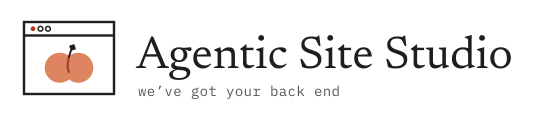
</h1>

<p align="center">
  <b>Build static websites with AI, from brief to live site.</b><br>
  The AI drafts; people decide.
</p>

<p align="center">
  
  
  
  
  
  
</p>

<p align="center">
  <a href="#the-workflow">Workflow</a> ·
  <a href="#screens">Screens</a> ·
  <a href="#how-it-fits-together">Architecture</a> ·
  <a href="#run-it-locally">Run it locally</a> ·
  <a href="#tests">Tests</a> ·
  <a href="#documentation">Documentation</a>
</p>

<p align="center">
  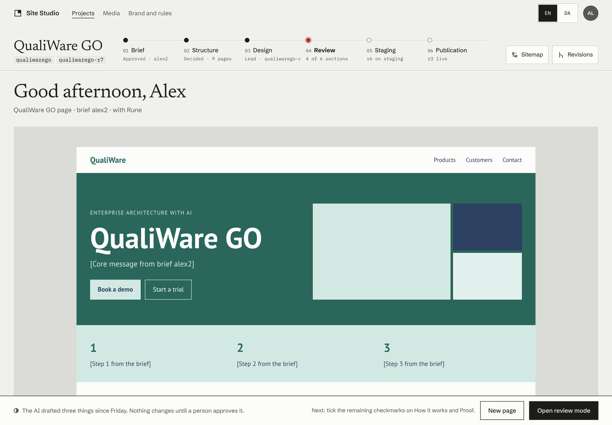
</p>

---

Site Studio is a web app where people without design or technical skills build static websites with AI. A **Creator** works on design and content. An **Admin** can do everything a Creator can, and also handles production, deployment and governance.

> [!IMPORTANT]
> **Status: release candidate `0.1.0-rc.1`.** Milestones M1–M8 are built and tested locally, with every AI feature running against a mock model. It has not yet run on real hosts. See [CHANGELOG.md](CHANGELOG.md) for what is in this release and what is still open.

## The workflow

| 01 · Brief | 02 · Structure | 03 · Design | 04 · Review | 05 · Staging | 06 · Publication |
|:--|:--|:--|:--|:--|:--|
| Blocks with sources; open questions never block | Site tree, menus, hidden pages and own addresses | One Lead per page; more takes only on request | Seven checkmarks per section, ticked by a person | The exact package that will go live | Released only with an Admin’s passkey |

Every screen answers three questions: where you are in the workflow, what the AI did, and what a person has to decide next.

## Screens

<table>
  <tr>
    <td width="50%">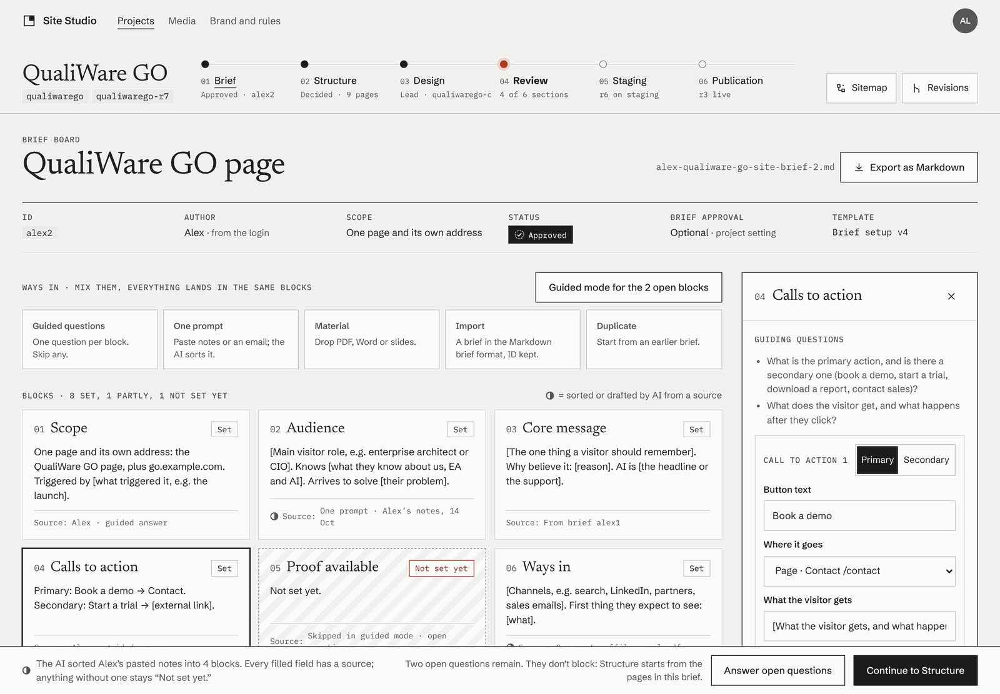<br><b>Brief board</b> · blocks with their sources, guided questions and open questions</td>
    <td width="50%">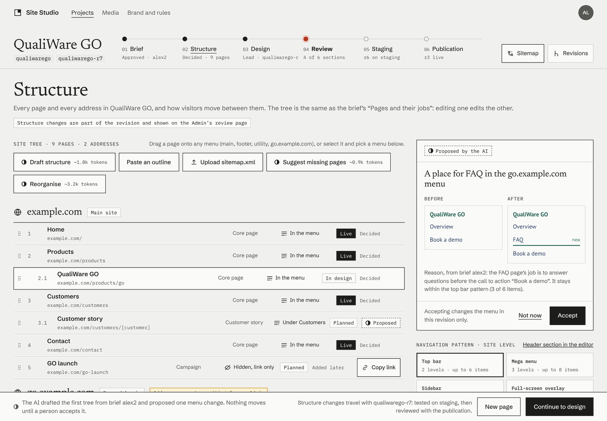<br><b>Structure</b> · site tree, menus by drag and drop, AI proposals as before and after</td>
  </tr>
  <tr>
    <td>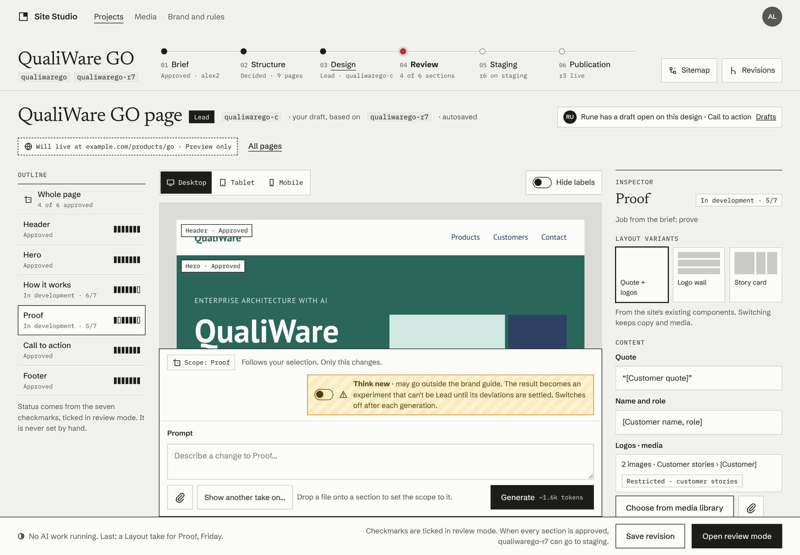<br><b>Design editor</b> · outline, the page at full size, inspector and a prompt bar scoped to the selection</td>
    <td>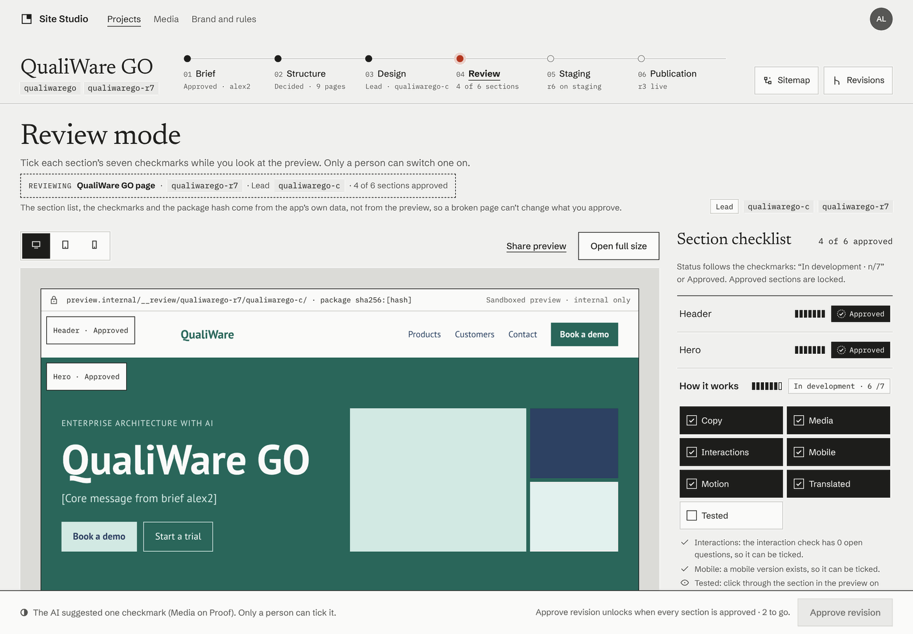<br><b>Review mode</b> · the seven checkmarks per section, approval only when every section is done</td>
  </tr>
  <tr>
    <td>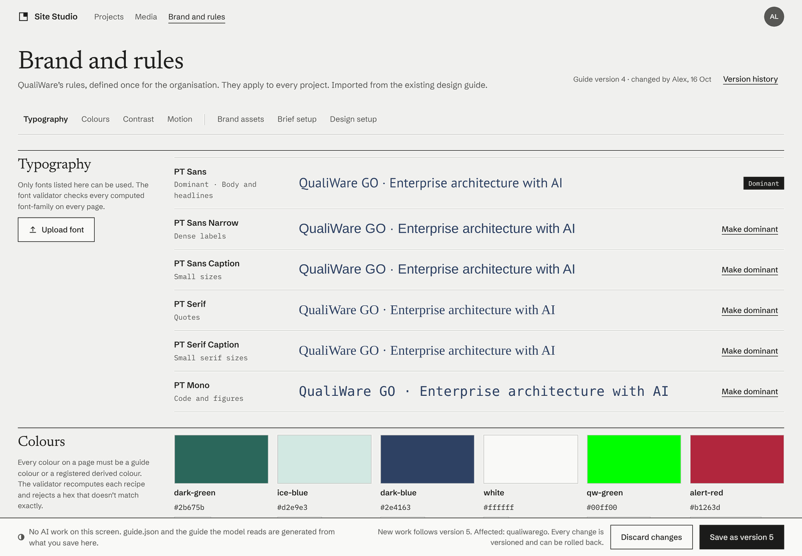<br><b>Brand and rules</b> · fonts, colours, OKLab derived colours and a live contrast table</td>
    <td>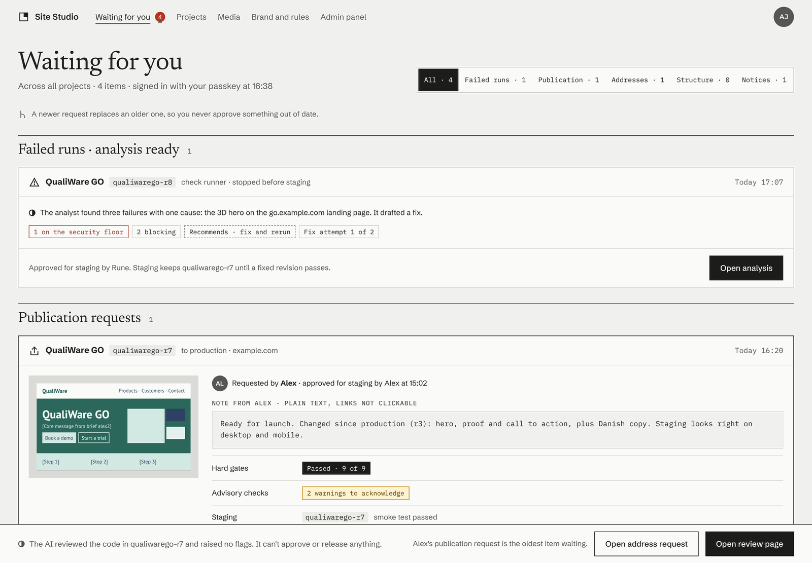<br><b>Waiting for you</b> · the Admin inbox across all projects</td>
  </tr>
  <tr>
    <td>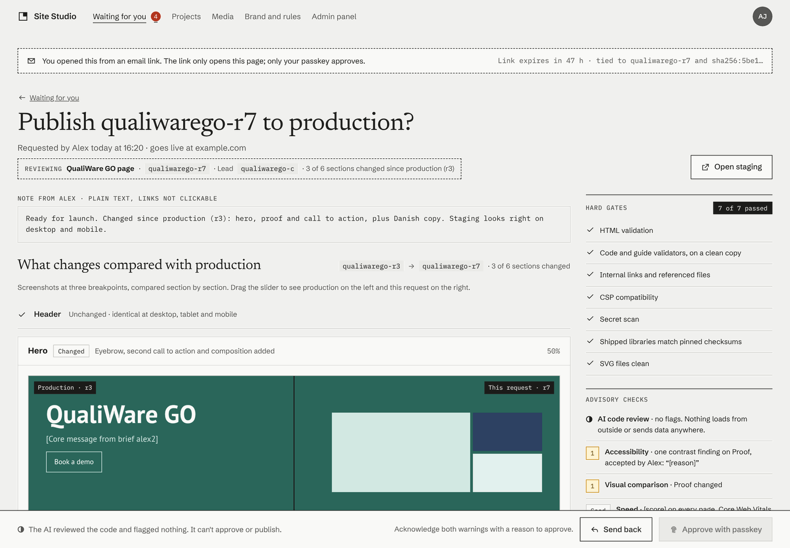<br><b>Publication review</b> · per-section comparison with production, then approve with a passkey</td>
    <td>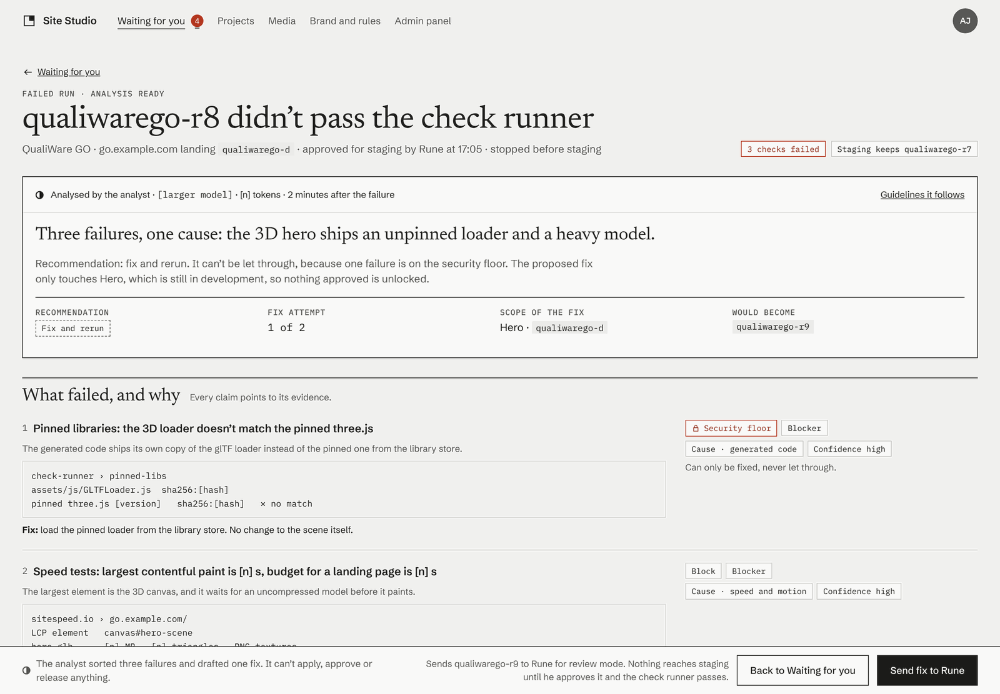<br><b>Failure analysis</b> · a larger model explains a failed run and drafts a fix; a person decides</td>
  </tr>
  <tr>
    <td colspan="2">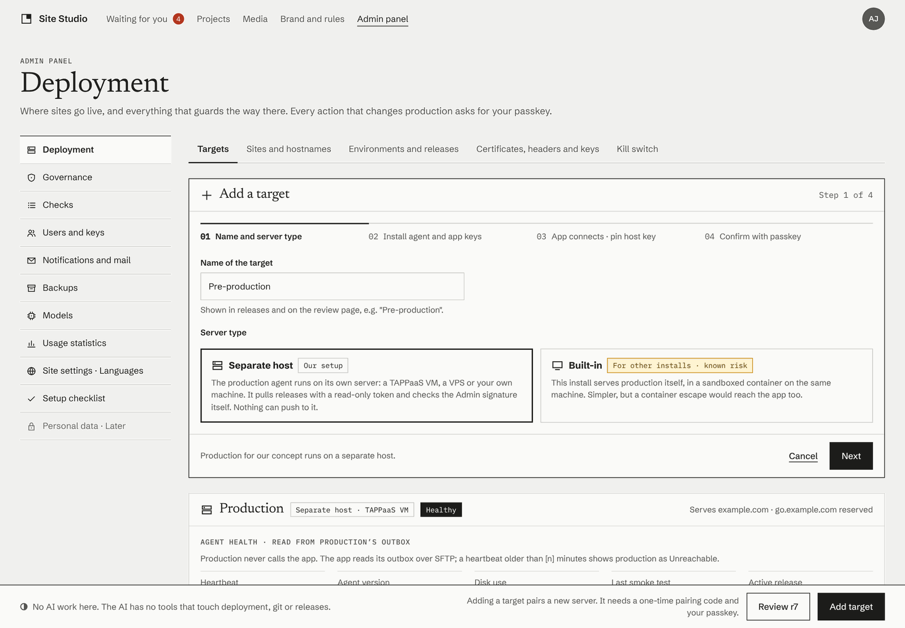<br><b>Deployment</b> · production paired over SFTP, health from its outbox, certificates, releases and the kill switch</td>
  </tr>
</table>

<sub>Screens are from the design prototype in <a href="design/"><code>design/</code></a>, which the app follows.</sub>

## How it fits together

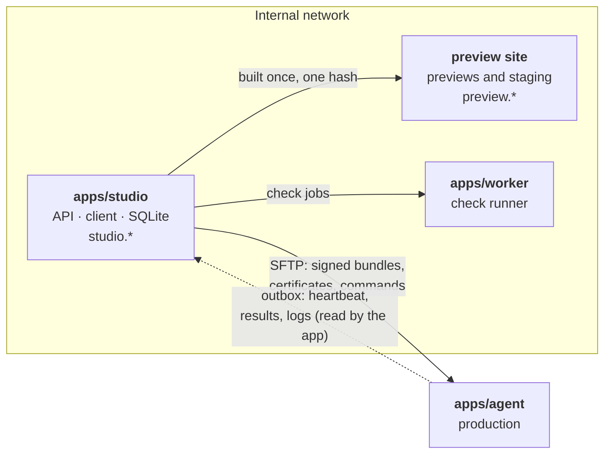

| Part | Path | Runs on |
|---|---|---|
| App: API, client and preview site | `apps/studio` | Bun + Hono, Svelte SPA, SQLite |
| Check runner: HTML, links, CSP, axe, Lighthouse | `apps/worker` | Node + Playwright, on its own host |
| Production agent: inbox → live site → outbox | `apps/agent` | Its own host; it never connects to the app |
| Shared code: OKLab colours, validators, signing | `packages/shared` | Used by all three |

### Security in short

- **The AI has no tools with consequences.** It returns data that code validates; it can’t release, delete or change settings.
- **Nothing is overwritten.** Revisions and files are immutable; everyone edits in a private draft.
- **Generated code never runs on the app’s site.** The app (`studio.*`) and the previews (`preview.*`) are separate sites.
- **Built once, byte-identical.** Preview, staging and production serve the same package with the same hash.
- **Production only accepts releases signed with an Admin’s passkey**, and it never calls the app.

The full security floor is in [CLAUDE.md](CLAUDE.md#rules-that-must-never-break).

## Run it locally

| You need | Version |
|---|---|
| Bun | 1.4 |
| Node | 24 |
| Microsoft Edge | for the browser tests and the speed check |

```sh
bun install
cp .env.example .env     # then fill in DATA_DIR, APP_SECRET and the LLM_* values
bun run dev              # app at http://localhost:3000, preview at http://127.0.0.1:3001
```

> [!NOTE]
> The Admin screens need an Admin passkey. When the app starts, it writes a one-time setup code to its log for each Admin who has no passkey yet. Each code works once and expires after 24 hours.

## Tests

```sh
bun test                 # unit and permission tests
bun run lint             # Biome + type check + svelte-check
bun run test:browser     # browser tests (Node + installed Edge)
bun run test:worker      # check runner (Node)
bun run test:agent       # production agent
```

## Documentation

| | |
|---|---|
| [docs/plan.md](docs/plan.md) | The full plan (v4.0) |
| [docs/decisions.md](docs/decisions.md) | Developer decisions, which override the plan |
| [docs/milestones/](docs/milestones/) | M0–M8, each with Done-when criteria and a Result |
| [docs/vm-setup.md](docs/vm-setup.md) | Hosting on TAPPaaS: VMs, zones, TLS |
| [design/](design/) | The clickable prototype, tokens and icon set |
| [contracts/](contracts/) | JSON schemas, the site CSP, fixtures and the permission test cases |

<p align="center">
  <br>
  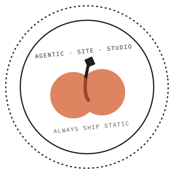
</p>

## License

Copyright (c) 2026 Andreas Jensen. Licensed under the [PolyForm Noncommercial License 1.0.0](LICENSE): you may use, change and share it for non-commercial purposes only. Commercial use needs permission.
